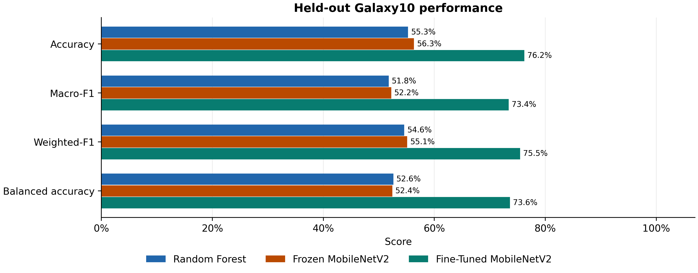

# Galaxy Morphology Classification

This repository studies **galaxy shapes** in two related but separate tasks:

1. **Elliptical versus spiral:** reconstruct the traditional machine-learning
   experiment in [Barchi et al.](https://doi.org/10.1016/j.ascom.2019.100334)
   using released CyMorph measurements, Galaxy Zoo 1 labels, and SDSS DR7
   metadata.
2. **Ten-class galaxy morphology:** compare a seven-feature Random Forest
   with frozen and fine-tuned MobileNetV2 on Galaxy10 DECaLS images.

Despite the repository's historical name, the final experiments **do not
classify stars**. The tasks use different datasets, labels, and test sets;
their accuracy numbers should not be compared directly.

## Results at a glance

### 1. Elliptical versus spiral

The [DR7-filtered reconstruction](Kishore/paper_replication/results/catalog_dr7_complete_case/REPORT.md)
joins the authors' CyMorph feature catalog to independent Galaxy Zoo 1
elliptical/spiral labels. It evaluates a majority baseline, Decision Tree,
SVM, and multilayer perceptron (MLP) at three image-resolution thresholds.
Each K threshold produces a different eligible sample.

| K threshold | Eligible galaxies | Held-out galaxies | Best held-out accuracy | Model | Macro-F1 |
| --- | ---: | ---: | ---: | --- | ---: |
| K >= 5 | 95,209 | 19,125 | 95.84% | MLP | 0.9182 |
| K >= 10 | 82,736 | 16,552 | 96.63% | MLP | 0.9312 |
| K >= 20 | 53,220 | 10,674 | 97.22% | MLP | 0.9362 |

At K >= 20, Decision Tree, SVM, and MLP attained **97.06%, 97.15%, and
97.22%** held-out accuracy. The paper reports **98.5%, 98.6%, and 98.6%**
for its corresponding Table 3 models. Our samples and split protocol differ
from the paper's, so these are not exact like-for-like comparisons. The
DR7-filtered sample also has fewer galaxies than the paper's Table 1 at each
threshold. See the [paper-to-code specification](Kishore/paper_replication/SPECIFICATION.md),
[status and caveats](Kishore/paper_replication/STATUS.md), and
[full DR7 report](Kishore/paper_replication/results/catalog_dr7_complete_case/REPORT.md).

### 2. Ten-class Galaxy10 DECaLS

The official file has **17,736** images. Three blank images were excluded,
leaving **17,733** usable images: **14,188** development and **3,545** held-out
test images. The three models use the **same test rows and class order**.

| Model | Held-out accuracy | Macro-F1 | Balanced accuracy |
| --- | ---: | ---: | ---: |
| Seven-feature Random Forest | 55.26% | 0.5178 | 52.62% |
| Frozen MobileNetV2 | 56.33% | 0.5224 | 52.43% |
| Fine-tuned MobileNetV2 | **76.22%** | **0.7342** | **73.63%** |

Fine-tuned MobileNetV2 correctly classified **2,702 of 3,545** held-out
galaxies. The frozen network and Random Forest performed similarly; the
adapted model improved both overall and class-balanced scores. The
[three-model report](comparison/three_model/THREE_MODEL_REPORT.md) explains
the shared split, alignment audit, per-class results, and paired analysis.
The comparison recomputes scores from saved predictions; it does not rerun
the supplied fine-tuning procedure or weight-level inference.



## What we did

### Binary catalog reconstruction

We used the released **CyMorph** measurements as model inputs rather than
claiming to reproduce the original scientific image-processing pipeline from
raw SDSS frames. **Galaxy Zoo 1** supplies the labels, joined by exact SDSS
DR7 object ID. The DR7 follow-up checks available metadata and retains rows
meeting its selection and quality rules. For each K threshold, models are
selected within development data using nested cross-validation, then refitted
and evaluated on a separate holdout. Object groups stay in one partition.
The original class imbalance is retained, with a majority-class baseline.

The [original catalog run](Kishore/paper_replication/results/catalog/REPORT.md),
[complete-case follow-up](Kishore/paper_replication/results/catalog_complete_case/REPORT.md),
[exact-SVM sensitivity run](Kishore/paper_replication/results/catalog_complete_case_exact_svm/REPORT.md),
and [DR7-filtered follow-up](Kishore/paper_replication/results/catalog_dr7_complete_case/REPORT.md)
are retained separately. The later follow-ups use a previously inspected
holdout; they are follow-up analyses rather than fresh blind evaluations.
The [specification](Kishore/paper_replication/SPECIFICATION.md) records
reconstruction decisions and unresolved image-feature parity.

### Ten-class image classification

- **Random Forest:** measure concentration, asymmetry, smoothness, entropy,
  Gini, M20, and ellipticity from each RGB cutout, then fit a 160-tree forest.
  Five outer folds estimate development performance; inner folds tune each
  outer training set. The final model is refitted on development data. See
  [feature definitions](Kishore/METHODS.md) and the
  [Random Forest report](Kishore/results/final/REPORT.md).
- **Frozen MobileNetV2:** extract image features with a pretrained backbone
  kept frozen, then train a ten-class head. See the
  [frozen baseline report](Sagar/results/frozen_baseline_full/results_report.md).
- **Fine-tuned MobileNetV2:** warm up the head, then adapt selected upper
  backbone layers to galaxy images while keeping BatchNormalization frozen.
  See the [training addendum](Sagar/results/finetuned_mobilenetv2/README_FINETUNING_ADDENDUM.md)
  and [results](Sagar/results/finetuned_mobilenetv2/finetuned_results_report.md).

The shared split keeps known exact-image and near-coordinate repeats from
crossing between development and test. The
[alignment audit](comparison/three_model/audit/alignment_audit.json) matches
all prediction exports by row ID and label. The
[comparison figures](comparison/three_model/figures/) show overall and
per-class results, confusion patterns, and paired uncertainty intervals.

## Repository guide

| Path | Contents |
| --- | --- |
| [`Kishore/`](Kishore/) | Galaxy10 feature extraction, Random Forest, tests, and results |
| [`Kishore/paper_replication/`](Kishore/paper_replication/) | CyMorph/Galaxy Zoo catalog reconstruction, DR7 follow-up, reports, audits |
| [`Sagar/`](Sagar/) | MobileNetV2 source, notebook, archived models, prediction exports, reports |
| [`comparison/three_model/`](comparison/three_model/) | Shared Galaxy10 comparison, figures, statistics, verification |
| [`data/paper_catalogs/`](data/paper_catalogs/) | Catalog archives already present in the original repository |
| [`Paper.pdf`](Paper.pdf) | Local reference copy of the Barchi et al. paper |
| [`Paper_Classification.ipynb`](Paper_Classification.ipynb) and [`results/paper_notebook/`](results/paper_notebook/) | Earlier notebook experiment, separate from the final two-task analysis |

## Reproduce and inspect

Run in **Ubuntu under WSL**, with Python 3.10 or newer. These commands start
from the repository root. Full training takes substantial CPU time; the saved
reports and figures can be read without rerunning it.

```bash
python3 -m venv Kishore/.venv
Kishore/.venv/bin/python -m pip install -r Kishore/requirements.txt
cd Kishore
.venv/bin/python -m unittest discover -s tests -v
.venv/bin/python main.py smoke
```

For the full Galaxy10 run, the verified downloader obtains the
[official HDF5](https://zenodo.org/records/10845026/files/Galaxy10_DECals.h5),
or you can place it at `Kishore/data/raw/Galaxy10_DECals.h5`. The expected
SHA-256 is in [`acquisition.py`](Kishore/acquisition.py). From `Kishore/`:

```bash
.venv/bin/python main.py download
.venv/bin/python main.py verify
.venv/bin/python main.py all
.venv/bin/python main.py check
```

For a paper-replication smoke run, start again at the repository root:

```bash
Kishore/.venv/bin/python -m pip install -r Kishore/paper_replication/requirements.txt
cd Kishore/paper_replication
../.venv/bin/python -m unittest discover -s tests -v
../.venv/bin/python main.py smoke --workers 1
```

Full reconstruction needs the [CyMorph release](https://data.mendeley.com/datasets/tg7c985c2n/1)
and [Galaxy Zoo 1 labels](https://data.galaxyzoo.org/). The DR7-filtered
follow-up also needs an SDSS CasJobs metadata export **not included here**.
Follow the [paper-replication guide](Kishore/paper_replication/README.md) for
acquisition, the export query, full commands, and audits. The
[comparison guide](comparison/three_model/README.md) explains how to
regenerate Galaxy10 tables and figures from saved predictions with the
required original HDF5.

## Data, provenance, and limitations

- The roughly **2.6 GB Galaxy10 HDF5**, local environments, caches, raw
  replication inputs, and oversized generated split/manifest files are
  excluded from Git. This repository includes many models, prediction
  exports, reports, and figures, but is **not a complete raw-data archive**.
- Binary models use the authors' released CyMorph measurements. Agreement
  with measurements independently extracted from raw SDSS images remains
  unverified. The DR7 samples and split protocol differ from the paper.
- The MobileNetV2 test outputs are retained as supplied artifacts. The
  comparison checks alignment and recomputes scores from predictions; it
  does not independently reproduce the fine-tuned training run.
- Galaxy10 scores concern ten galaxy morphology classes on this dataset.
  They do not establish performance on stars, other surveys, or unlabeled
  local cutouts. Model probabilities are not guaranteed to be calibrated.

For exact metrics, per-class tables, provenance hashes, and methodological
details, use the linked reports rather than rounded headline numbers.
